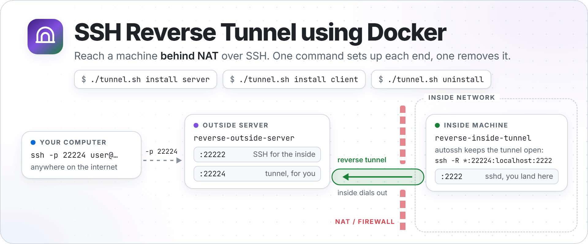
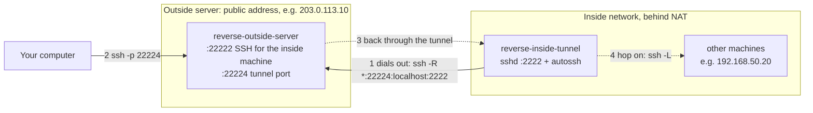
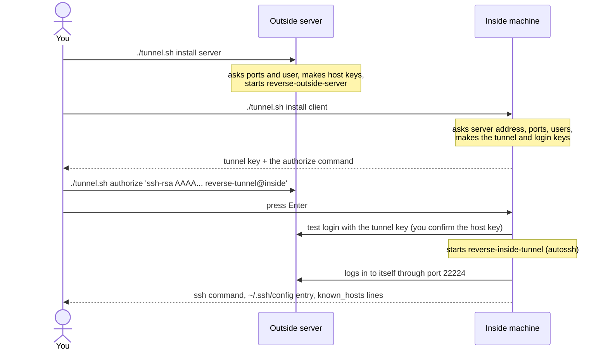

<p align="center">
  <picture>
    <source media="(prefers-color-scheme: dark)" srcset="https://raw.githubusercontent.com/NatLee/ssh-reverse-tunnel-using-docker/main/docs/images/hero-dark.png">
    
  </picture>
</p>

<p align="center">
  <a href="https://github.com/NatLee/ssh-reverse-tunnel-using-docker/actions/workflows/ci.yml"></a>
  
  
</p>

> You can explore a more convenient option on [Telepy](https://github.com/NatLee/telepy).

Reach a machine that sits behind NAT or a firewall, over plain SSH. The inside
machine runs a small SSH server in Docker and keeps an outgoing connection
(autossh) open to an outside server you control, for example any VPS with a
public address. The outside server opens a port that leads back through that
connection, so `ssh -p 22224 user@your-server` lands on the inside machine.
Nothing on the inside network has to accept a connection from the internet.

One command sets up each end, and one removes it:

```bash
./tunnel.sh install server   # on the outside server
./tunnel.sh install client   # on the inside machine
./tunnel.sh uninstall        # on either one, when you are done
```

- [How it works](#how-it-works)
- [What you need](#what-you-need)
- [Install](#install) · [Without questions](#without-questions-automation) · [Uninstall](#uninstall)
- [Commands](#commands) · [Settings](#settings-env) · [Coming from the old scripts](#coming-from-the-old-scripts)
- [Security notes](#security-notes) · [Windows](#windows) · [Troubleshooting](#troubleshooting) · [Tests](#tests)

## How it works



1. The inside container logs in to the outside server on port 22222 with its
   tunnel key and asks it to open port 22224 (`ssh -R`). autossh starts that
   connection again whenever it drops.
2. You connect to port 22224 on the outside server.
3. The outside server hands the connection back through the tunnel to the
   inside container's sshd. You log in there with the login key.
4. From the inside container you can reach the other machines on the inside
   network, for example with `ssh -L`.

Both ends run the [linuxserver/openssh-server](https://docs.linuxserver.io/images/docker-openssh-server)
image. `tunnel.sh` keeps the settings in `.env` and the keys under `src/`.

## What you need

- Docker with Compose 2.24 or newer (`docker compose version`), usable by your
  user (the `docker` group) or with `sudo`.
- bash and the OpenSSH client (`ssh`, `ssh-keygen`). Linux and macOS have them;
  on Windows use [WSL 2](#windows).
- An outside server with a public address and two open TCP ports: 22222 (the
  inside machine connects) and 22224 (you connect). Both can be changed.

CI tests everything on Linux. The script also avoids anything newer than the
bash 3.2 of macOS, but nobody has tried it on a Mac yet.

## Install

Get the repo on both machines:

```bash
git clone https://github.com/NatLee/ssh-reverse-tunnel-using-docker.git
cd ssh-reverse-tunnel-using-docker
```

No git? `curl -fsSL https://github.com/NatLee/ssh-reverse-tunnel-using-docker/archive/refs/heads/main.tar.gz | tar xz`
gives you the same files in `ssh-reverse-tunnel-using-docker-main/`. There is
no `curl ... | bash` installer on purpose: `tunnel.sh` needs the compose files
and the sshd settings next to it anyway, and piping a download into bash runs
code you have not seen (half of it, if the download breaks).



### 1. On the outside server

```bash
./tunnel.sh install server
```

It checks Docker, then asks three things. Enter keeps the value in brackets:

```text
  SSH port of this server (the inside machines connect to it) [22222]:
  Tunnel port (you connect to it to reach the inside machine) [22224]:
  User name the inside machines log in as [user]:
```

It makes the host keys, starts the container `reverse-outside-server`, and
prints the host key fingerprints plus the command to run on the inside machine.
It also offers to take the inside machine's tunnel key right away; press Enter
to add it later. Open both ports in the server's firewall.

### 2. On the inside machine

```bash
./tunnel.sh install client
```

It asks for the outside server's address, its two ports and the user names,
makes the keys and shows the tunnel key together with the command for the
outside server:

```bash
./tunnel.sh authorize 'ssh-rsa AAAA... reverse-tunnel@inside'
```

Run that on the outside server, then press Enter on the inside machine. The
installer logs in to the outside server once to check the key; the first time,
ssh shows the server's host key, so compare it with the fingerprints from
step 1 and type `yes`. Then it starts `reverse-inside-tunnel`, logs in to
itself through port 22224 to prove the tunnel works, and prints what you need
on your computer.

If your outside server is a plain SSH server instead of this repo, add the key
to `~/.ssh/authorized_keys` there, or pick "copy it now with ssh-copy-id". Its
sshd needs `AllowTcpForwarding yes` and `GatewayPorts clientspecified` (or
`yes`), otherwise the tunnel port only listens on the server's localhost.

### 3. On your computer

Copy the login key `src/user_ssh_key/id_rsa` from the inside machine to your
computer, for example as `~/.ssh/inside-tunnel_id_rsa`, and keep it private
(`chmod 600`). Then:

```bash
ssh -p 22224 -i ~/.ssh/inside-tunnel_id_rsa user@203.0.113.10
```

Or put the entry that install printed into `~/.ssh/config` and just run
`ssh inside-tunnel`:

```text
Host inside-tunnel
    HostName 203.0.113.10
    Port 22224
    User user
    IdentityFile ~/.ssh/inside-tunnel_id_rsa
```

Install also prints `known_hosts` lines for the inside container's host keys.
Add them to `~/.ssh/known_hosts` on your computer, and ssh can tell that it
really reached your inside machine, even the first time.

To reach another machine on the inside network, forward a port through the
inside container. This opens the web page of `192.168.50.20` at
http://localhost:8080 on your computer:

```bash
ssh -f -N -L 8080:192.168.50.20:80 inside-tunnel
```

## Without questions (automation)

Every question has an option and an environment variable with the same name as
the `.env` setting. `--yes` (or running without a terminal) turns the questions
off; then options win over environment variables, which win over `.env`, which
wins over the defaults in `.env.example`.

| Option | Setting | Default |
| --- | --- | --- |
| `--server-host` | `REVERSE_SERVER_HOST` | none, the client needs it |
| `--server-port` | `REVERSE_SERVER_SSH_PORT` | `22222` |
| `--server-user` | `REVERSE_SERVER_USER_NAME` | `user` |
| `--tunnel-port` | `REVERSE_TUNNEL_SSH_PORT` | `22224` |
| `--user` | `USER_NAME` | `user` |
| `--authorize-key KEY_OR_FILE` | server: accept this tunnel key (repeatable) | |
| `--copy-key` | client: run ssh-copy-id instead of asking | |

When nobody is there to press Enter, make the tunnel key first, so the server
can accept it before the client starts:

```bash
# inside machine: make the keys, then copy ~/tunnel.pub to the outside server
./tunnel.sh keygen client
./tunnel.sh pubkey > ~/tunnel.pub

# outside server
./tunnel.sh install server --yes --authorize-key ~/tunnel.pub

# inside machine
./tunnel.sh install client --yes --server-host 203.0.113.10
```

Running install again is safe. It keeps the keys, shows the current settings as
the defaults and restarts the container only if something changed.

## Uninstall

```bash
./tunnel.sh uninstall
```

This always stops and removes the containers and their network. On a terminal
it then asks whether to remove more, lists everything it is about to remove,
and waits for a yes. You can also say it up front:

| Option | Also removes | Can be undone? |
| --- | --- | --- |
| (none) | only the containers and the network | yes: `./tunnel.sh start` |
| `--images` | the openssh-server image | yes: it is pulled again |
| `--keys` | the keys in `src/` (tunnel, login, host keys, `known_hosts`, `authorized_keys`) | no |
| `--env` | `.env` | no |
| `--logs` | `logs/` | no |
| `--all` | all of the above | no |

Without a terminal, uninstall refuses to delete files unless you add `--yes`:

```bash
./tunnel.sh uninstall --all --yes
```

After `--all`, the folder is exactly as you cloned it; delete it when you like.
If you delete an inside machine's keys, the outside server still accepts the
old tunnel key. Uninstall reminds you to remove its line from
`src/server-config/root_ssh_key/authorized_keys` on the server.

## Commands

The role (`client` or `server`) can be left out after install, which saves it
in `.env`.

| Command | What it does |
| --- | --- |
| `./tunnel.sh install client\|server` | Set up this end (see above). |
| `./tunnel.sh uninstall [client\|server]` | Remove this end (see above). |
| `./tunnel.sh start [role] [--foreground]` | Start in the background, or attached like the old `run-*.sh`. |
| `./tunnel.sh stop [role]` | Stop the container. |
| `./tunnel.sh status [role]` | Show the containers and how to connect. |
| `./tunnel.sh logs [role] [-f ...]` | `docker compose logs` for this end. |
| `./tunnel.sh keygen [role]` | Make new keys. Asks first if keys exist (`--yes` skips). |
| `./tunnel.sh pubkey` | Print the tunnel public key of this inside machine. |
| `./tunnel.sh authorize KEY\|FILE\|-` | Outside server: accept an inside machine's tunnel key. |
| `./tunnel.sh copy-key` | Put the tunnel key on the outside server with ssh-copy-id. |
| `./tunnel.sh connect-outside [command]` | SSH to the outside server with the tunnel key. |
| `./tunnel.sh shell` | Open a shell in the inside container. |

## Settings (.env)

`install` writes `.env` for you. `.env.example` lists every setting with its
default.

| Setting | Used by | What it is |
| --- | --- | --- |
| `TUNNEL_ROLE` | tunnel.sh | `client` or `server`, set by install |
| `REVERSE_SERVER_HOST` | client | address of the outside server (domain or IP) |
| `REVERSE_SERVER_SSH_PORT` | both | SSH port of the outside server |
| `REVERSE_SERVER_USER_NAME` | client | user name on the outside server |
| `REVERSE_TUNNEL_SSH_PORT` | both | port on the outside server that leads back |
| `USER_NAME` | both | server: who the inside machines log in as; client: who you log in as |
| `USER_PASSWORD` | client | sudo password inside the inside container, random by default |
| `PUID`, `PGID` | both | uid/gid of the container user, your own by default |
| `TZ` | both | time zone of the containers |
| `OPENSSH_IMAGE` | both | the image, e.g. pin a version tag here |

To run several tunnels through one outside server, give each inside machine its
own tunnel port and add a `ports:` line for it in `docker-compose.server.yml`.

## Coming from the old scripts

The five scripts still work and print the new command. They only call
`tunnel.sh` and will go away in a later release.

| Old | New |
| --- | --- |
| `bash ./keygen.sh` | `./tunnel.sh keygen client` |
| `bash ./keygen-server.sh` | `./tunnel.sh keygen server` |
| `bash ./run-client.sh` | `./tunnel.sh start client --foreground` |
| `bash ./run-server.sh` | `./tunnel.sh start server --foreground` |
| `bash ./connect-outside-use-client-key.sh` | `./tunnel.sh connect-outside` |
| `echo $(cat ./src/root_ssh_key/id_rsa.pub)` | `./tunnel.sh pubkey` |
| `ssh-copy-id ... -i ./src/root_ssh_key/id_rsa` | `./tunnel.sh copy-key` |
| `docker exec -it reverse-inside-tunnel /bin/bash` | `./tunnel.sh shell` |

Your keys stay where they were, so the outside server keeps accepting them.
`./tunnel.sh start` adds the new settings to an old `.env` (a random
`USER_PASSWORD` instead of the old fixed `1234`, your uid/gid, `TZ`,
`OPENSSH_IMAGE`). A container started by the old scripts is replaced the first
time you start the new one.

## Security notes

- Login is by key only. Password login and root login are off on both ends;
  check with the `sshd -T` command at the top of `src/sshd_config.d/tunnel.conf`.
- The keys never leave your machines: `.gitignore` covers every key folder,
  `.env` and `logs/`. Private keys are created with mode 600.
- autossh remembers the outside server's host key the first time (after you
  confirmed it during install) and refuses a different one later. The old
  setup accepted any host key.
- Port 22224 on the outside server is open to the internet and leads to the
  inside container's sshd. Anyone can knock, but only your login keys get in.
- The outside server uses `GatewayPorts clientspecified`, so a tunnel only
  listens where the client asks for it.
- As before, both containers give their user `sudo`. On the inside it asks for
  `USER_PASSWORD` (random, in `.env`). On the outside server it does not ask:
  the tunnel user can become root inside that container.

## Windows

Use WSL 2:

1. Install WSL with Ubuntu (`wsl --install` in PowerShell) and Docker Desktop
   with "Use the WSL 2 based engine" and WSL integration for Ubuntu turned on,
   or Docker Engine inside Ubuntu.
2. Open Ubuntu and clone the repo into your Linux home (`~`), not under
   `/mnt/c`. Windows folders cannot hold the 600 permissions ssh insists on.
3. Run `./tunnel.sh install client` (or `server`) there, as above.

The repo keeps LF line endings (`.gitattributes`), so a clone made with Git for
Windows does not break the scripts. To connect from Windows itself, the
built-in OpenSSH client works in PowerShell:
`ssh -p 22224 -i $HOME\.ssh\inside-tunnel_id_rsa user@203.0.113.10`.
If it complains that the key file's permissions are too open, remove every
other user from the file's security settings.

## Troubleshooting

- **The tunnel check failed.** Is the tunnel key accepted on the outside
  server (`./tunnel.sh connect-outside true` tells you)? Is port 22224 open in
  its firewall? `./tunnel.sh logs -f` shows what autossh says. autossh keeps
  trying, so the tunnel comes up as soon as the problem is fixed.
- **"REMOTE HOST IDENTIFICATION HAS CHANGED" in the logs** after you rebuilt
  the outside server: if you expected that, forget the old key with
  `ssh-keygen -R "[203.0.113.10]:22222" -f src/root_ssh_key/known_hosts`, then
  `./tunnel.sh start`.
- **"Permissions could not be set ... read-only"** in the container logs is
  expected. The sshd settings are mounted read-only, so the image cannot change
  them.
- **A banner says the custom scripts are not owned by root.** Also expected:
  the inside container runs `src/custom_scripts` from your checkout, which
  belongs to you.
- **sudo inside the inside container asks for a password.** It is
  `USER_PASSWORD` in `.env`.

## Tests

```bash
tests/e2e.sh
```

builds two "machines" with their own Docker (outside server and inside
machine), a NAT router, a laptop and another inside host, all on separate
Docker networks with the addresses used in this README. It installs both ends,
logs in from the laptop through the tunnel, reaches the other inside host,
recreates and restarts the containers, runs both installs again on a terminal,
then uninstalls both ends and checks that no container, network, image or
file is left. CI runs it, plus ShellCheck, on every pull request and on main.
